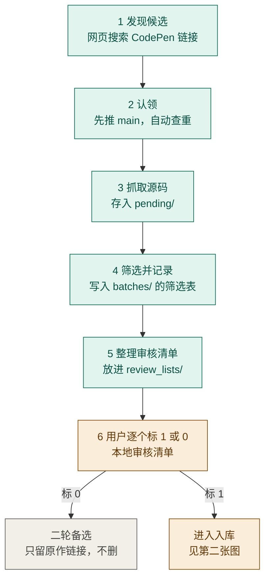
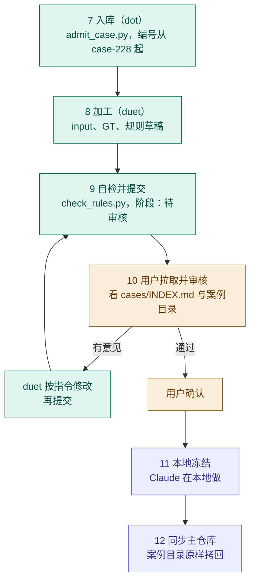

# 案例收集全流程

从找到候选作品，到案例入库、加工、审核、同步回主仓库。图在 GitHub 上会直接渲染；各步骤的命令和规则见 [data_intake/README.md](README.md)（采集）与 [cases/README.md](../cases/README.md)（入库后的加工）。

颜色：绿色是 dot、duet 在云端做的，橙色是用户做的，紫色是 Claude 在本地做的，灰色是结果。

## 一、从发现到用户标注（步骤 1–6）

## 二、从入库到同步回主仓库（步骤 7–12）

## 每一步对应的位置

| 步骤 | 谁 | 工具 | 产出位置 |
|---|---|---|---|
| 1 发现 | dot / duet | 网页搜索 | `data_intake/batches/<批次>/candidates.csv` |
| 2 认领 | dot / duet | `tools/claim.py` | `data_intake/ledger/claims.csv` |
| 3 抓取 | dot / duet | `scripts/codepen_collection/fetch_cdpn.py` | `data_intake/pending/<作者__ID>/` |
| 4 筛选 | dot / duet | `tools/peek.py`、`shot.py`、`decide.py` | `data_intake/batches/<批次>/screening.csv` |
| 5 清单 | dot / duet | — | `data_intake/review_lists/<日期>_<agent>/` |
| 6 标注 | 用户 | — | 审核清单里的 1 / 0；状态记入 `ledger/review.csv` |
| 7 入库 | dot | `tools/admit_case.py`（先预演，再 `--apply`） | `cases/case-NNN-TX/`、`cases/registry.csv` |
| 8 加工 | duet | 两个 skill（见 `reference/skills/`） | 案例目录里的 `input.json`、`ground_truth.html`、`rules_drafts/` |
| 9 自检 | duet | `scripts/case_tools/check_rules.py`、`tools/registry.py` | `registry.csv` 阶段改为 `ready_for_review` |
| 10 审核 | 用户 | — | 用户在本地审核，再向 duet 下达指令 |
| 11 冻结 | Claude（本地） | — | 案例目录里的 `FREEZE_v*.json` |
| 12 同步 | Claude（本地） | — | 主仓库 `cases/`，`registry.csv` 记 `synced` |
