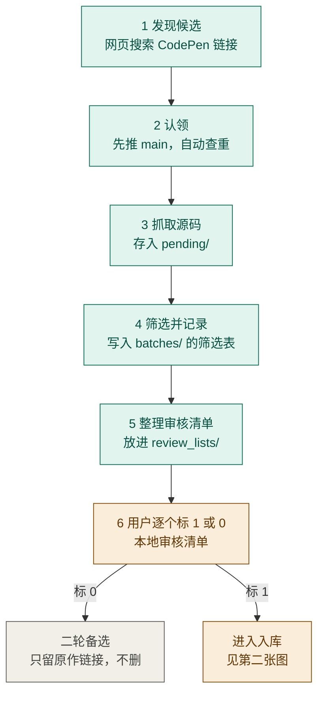
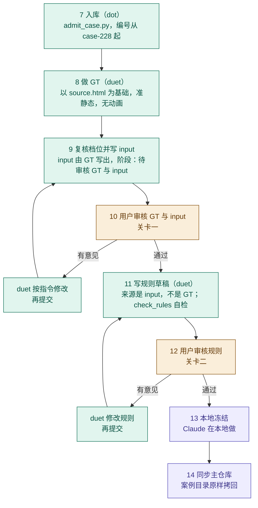

# 案例收集全流程

从找到候选作品，到案例入库、做准静态 GT、写 input、两次用户审核、规则、同步回主仓库。图在 GitHub 上会直接渲染；各步骤的命令和规则见 [data_intake/README.md](README.md)（采集）与 [cases/README.md](../cases/README.md)（入库后的加工）。

颜色：绿色是 dot、duet 在云端做的，橙色是用户做的，紫色是 Claude 在本地做的，灰色是结果。

## 一、从发现到用户标注（步骤 1–6）

## 二、从入库到同步回主仓库（步骤 7–14）

加工顺序是：**来源源码 → 准静态 GT → 由 GT 写出 input → 用户审核 → 规则 → 用户审核 → 本地冻结**。有两个审核关卡，每个关卡 duet 都停下等用户。

## 每一步对应的位置

| 步骤 | 谁 | 工具 | 产出位置 |
|---|---|---|---|
| 1 发现 | dot / duet | 网页搜索 | `data_intake/batches/<批次>/candidates.csv` |
| 2 认领 | dot / duet | `tools/claim.py` | `data_intake/ledger/claims.csv` |
| 3 抓取 | dot / duet | `scripts/codepen_collection/fetch_cdpn.py` | `data_intake/pending/<作者__ID>/` |
| 4 筛选 | dot / duet | `tools/peek.py`、`shot.py`、`decide.py` | `data_intake/batches/<批次>/screening.csv` |
| 5 清单 | dot / duet | — | `data_intake/review_lists/<日期>_<agent>/` |
| 6 标注 | 用户 | — | 审核清单里的 1 / 0；状态记入 `ledger/review.csv` |
| 7 入库 | dot | `tools/admit_case.py`（先预演，再 `--apply`） | `cases/case-NNN-TX/`（档位暂定）、`cases/registry.csv` |
| 8 做 GT | duet | Playwright 自检 | `ground_truth.html`、`review_<日期>/`、案例 README 里的改动说明；阶段 `gt_ready` |
| 9 复核档位、写 input | duet | `tools/registry.py retier` | `input.json`、`input_problem.md`；阶段 `input_draft` |
| 10 审核关卡一 | 用户 | `registry.py set-stage … input_approved --by-user` | 用户通过后阶段 `input_approved` |
| 11 写规则 | duet | `scripts/case_tools/check_rules.py` | `rules_drafts/manual_v1/`；阶段 `ready_for_review` |
| 12 审核关卡二 | 用户 | — | 用户审核规则 |
| 13 冻结 | Claude（本地） | `registry.py set-stage … frozen --local` | `FREEZE_v*.json` |
| 14 同步 | Claude（本地） | `registry.py set-stage … synced --local` | 主仓库 `cases/` |
